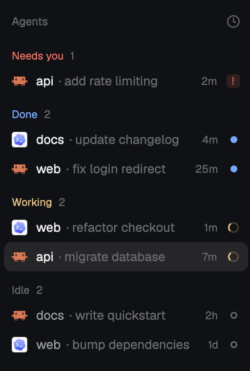

# Agents (unread)

The shipped Agents sidebar list with one addition: "mark as unread". An agent
that finished and that you already looked at (idle) can be put back to done,
so it keeps asking for your attention until you come back to it. Like marking
an email unread: read the answer now, deal with it later.

## What you see

Exactly the shipped `agents` mod (version 0.1.16): the "Agents" header with
the sort button, then the agents by priority (Needs you, Done, Working, Idle)
or grouped by space, pinned ones first, sub-agents as a tree under their
parent, and the numbered rail when the sidebar is narrow.

Two differences:

- Hovering a row whose agent is idle shows a small envelope button to the
  left of the pin button (13 px icon, dim, foreground on hover), tooltip
  "Mark as unread". On an unread row the button is an open envelope, tooltip
  "Mark as read".
- An unread agent looks like a done one in every way: the filled dot in the
  theme's `done` color, the foreground (not muted) name, the Done section in
  the priority sort, the done dot on a folded group header.

## How it behaves

- working, blocked, done, idle: as the shipped mod draws them. Only idle and
  done agents can be marked; marking a working or blocked one does nothing.
- Marking: click the envelope on a hovered row, or press the key bound to
  `agents-unread.toggle` (cmd-shift-u in the included `keys.json`), which
  toggles the agent that has focus.
- A marked agent shows as done at once, also while it still has focus.
- The mark ends when:
  - you focus the agent again after having focused something else (the same
    look that turns a real done into idle), by any route: a click on its
    row, a tab, a key;
  - you click its row while it already has focus;
  - the agent starts working or gets blocked (its own done follows later);
  - you click "Mark as read" or press the key again.
- Marks survive a restart.

## Built from

- A clone of the shipped `agents` mod (`mod.clone`), `mod.json` with
  `"place": "none"`: a layout shows it by using `"mod": "agents-unread"` in
  the block where it had `"mod": "agents"`.
- Marks live in shared state under `agents-unread.marked` as
  `{ "<terminal address>": true }`, so other mods (a tab bar, a spaces list)
  can read the same marks.
- `render` never writes. It computes the marks that still hold from
  `agents()` and keeps two in-memory sets: marked agents seen without focus
  (`left`) and marks that ended (`ended`). The list is then mapped so unread
  agents carry `status: "done"` and `unread: true` before sorting, grouping
  and drawing. The ended marks are written by `flush()` on the mod's
  30-second timer and by every toggle.
- `herdr` functions: `agents`, `terminals`, `panes`, `focused`, `spaces`,
  `theme`, `shared`, `setShared`, `setAgentOrder`, `openOverlay`,
  `closeOverlay`, `props`, `window`, `layout`, `nextCommand`, `run`.
  Commands: `pane.focus`, `terminal.pin`, `terminal.peek`, `layout.resize`.
- No network, no programs, no files outside its own folder.
- Art: `unread.svg` and `read.svg` (Lucide `mail` and `mail-open`), plus the
  shipped `mods/workspace-chrome/` icons the original uses.

## Watch out

- Only this list changes. The status a space or a tab shows comes from the
  app (`spaces()`), which knows nothing about the marks: they stay idle
  unless those mods read `agents-unread.marked` too.
- The app decides "looked at" with more than focus (it knows whether the
  window is in front); this mod only sees `focused`. A mark on the focused
  agent holds until focus goes elsewhere and comes back.
- Don't call `setShared` from `render`: it re-renders every mod. Remember
  what ended and write it from a timer or a handler.
- Don't drop marks of agents missing from `agents()` on a timer: the list is
  empty right after a start. Prune them only on a toggle.
- The time-in-state on each row is kept per mod copy, so it starts over
  ("<1m") the first time this mod replaces the shipped one.
- Installed under another name, rename the `mods/agents-unread/` icon paths,
  the `mod: "agents-unread"` of the sort popup and the key's command prefix.
- Sub-agents without a pane are never done and can't be marked.
